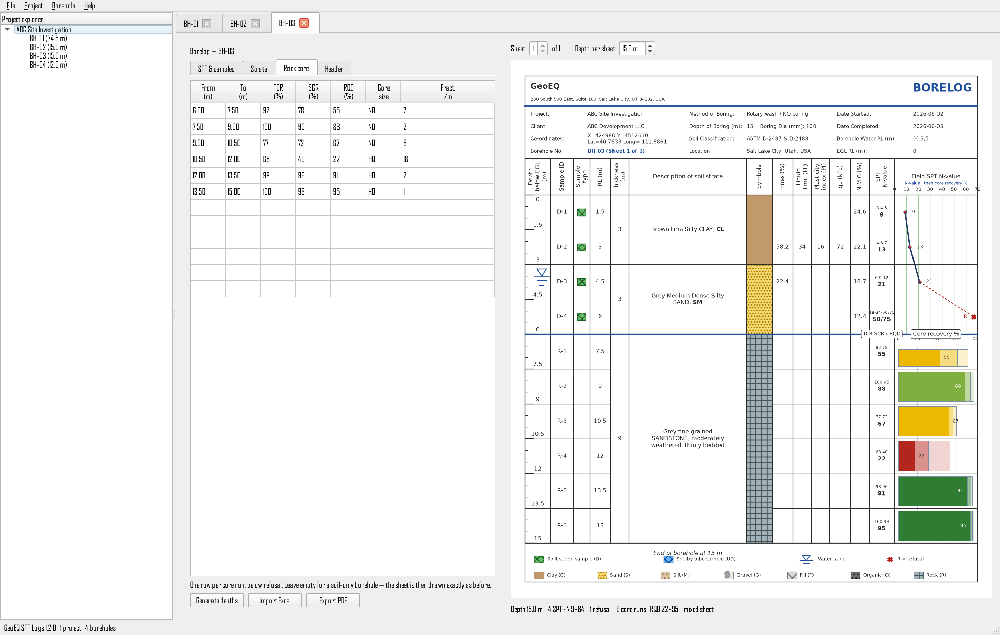
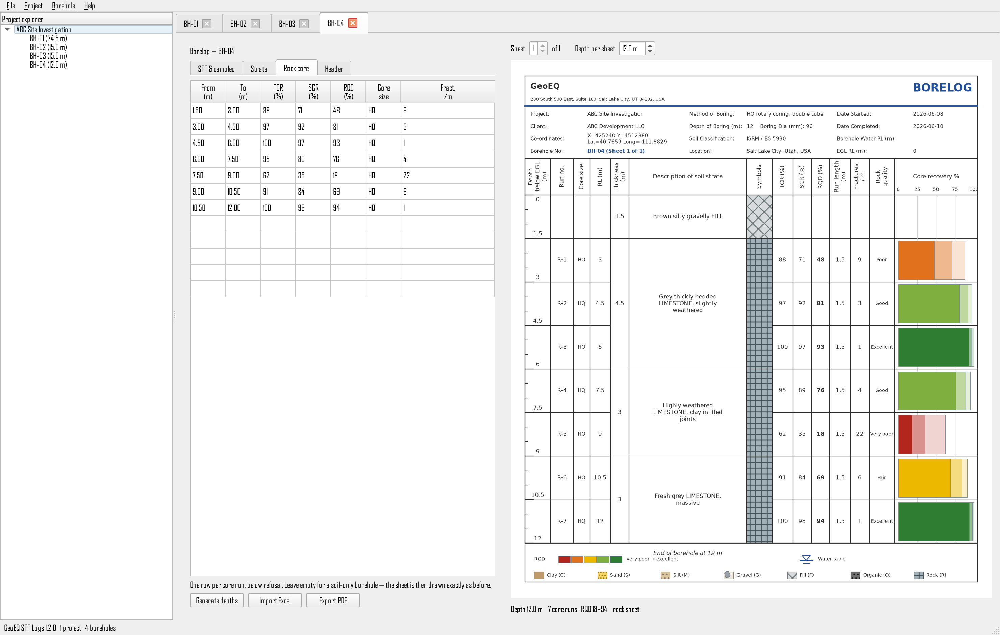

<p align="center">
  
</p>

<h1 align="center">GeoEQ SPT Logs — Free SPT Borelog Software</h1>

<p align="center">
  Create professional <b>SPT borehole logs</b> and <b>rock core logs</b> in
  minutes — enter or import field data, get template-quality
  <b>geotechnical borelog</b> sheets with <b>TCR, SCR and RQD</b> and
  print-ready PDF reports. Free borehole logging software for Windows.
</p>

<p align="center">
  <a href="https://github.com/geoeq/SPT-Borelogs/releases/latest"></a>
  <a href="https://github.com/geoeq/SPT-Borelogs/releases/latest"></a>
  <a href="#faq"></a>
  <a href="https://github.com/geoeq/SPT-Borelogs/releases"></a>
  <a href="https://github.com/geoeq/SPT-Borelogs/stargazers"></a>
</p>

<p align="center">
  <a href="#download--install">Download</a> ·
  <a href="manual.md">User manual</a> ·
  <a href="#screenshots">Screenshots</a> ·
  <a href="CHANGELOG.md">Changelog</a> ·
  <a href="#faq">FAQ</a> ·
  <a href="#support--feature-requests">Support</a>
</p>

---

## Why GeoEQ SPT Logs?

Most geotechnical teams still draw borehole logs in Excel templates —
slow, error-prone, and painful to keep consistent across a project.
Commercial borelog software is powerful but expensive and heavy.
**GeoEQ SPT Logs** sits in the sweet spot: a free, fast, purpose-built
borehole logging program that produces clean, standardized boring log
sheets — and imports the Excel files you already have.

- ✅ **Free** (version 1.x, full-featured — see [FAQ](#faq))
- ✅ **Soil and rock in one log** — SPT down to refusal, then core runs
  with **TCR, SCR and RQD**, on the same continuous sheet
- ✅ **Familiar output** — template-style borelog sheets engineers and
  reviewers recognize instantly
- ✅ **Your data stays yours** — plain JSON project files on your disk,
  works fully offline

## Screenshots

**Live borelog editor** — type in the tables on the left, the sheet
redraws instantly on the right:

<p align="center">
  
</p>

**Rock coring** — enter core runs and the sheet continues into rock by
itself: the N-value graph becomes core recovery, coloured by rock
quality:

<p align="center">
  
</p>

**Rock-only boreholes** — no SPT rows at all, so the columns carry the
core-run figures instead:

<p align="center">
  
</p>

**Import any spreadsheet** — non-standard headings are matched with an
assignment window (auto-guessed, you confirm):

<p align="center">
  
</p>

**Print-ready sheets** — A4 borehole log with soil symbols, USCS
classification, groundwater level, and the field SPT N-value profile:

<p align="center">
  
</p>

## Features

- **SPT borehole log sheets** drawn live: ruler depth scale, sample
  symbols (split spoon / Shelby tube), blow counts with computed
  **SPT N-value**, refusal handling, and the N-vs-depth profile graph
- **Rock core logging — TCR, SCR and RQD**: one row per core run, drawn
  as a single nested recovery bar coloured by **rock quality**
  (Deere: very poor → excellent). Core size, fractures per metre and run
  length included. Figures are checked against each other, so an RQD
  above its SCR is reported rather than silently accepted
- **Soil and rock on one continuous log**: enter core runs and the sheet
  follows your data — no mode to switch. SPT above the rockhead, core
  recovery below it; a borehole with no SPT at all draws as a rock sheet
- **Soil strata symbols** for Clay, Sand, Silt, Gravel, Fill, Organic
  and Rock — colored, textured, with **USCS group symbols** (ML, CL,
  SW…) printed bold in descriptions
- **Excel & CSV import**: office borelog templates import in one click;
  any other spreadsheet goes through a smart column-mapping dialog —
  even files that only carry N-values
- **Multi-project files**: one file holds several site-investigation
  projects, each with its own boreholes, client, and settings
- **One-click project PDF**: every borehole of a project exported into
  a single multi-page A4 report, in order
- **Your branding**: company name, address and logo, four header
  styles, custom accent color — set once, drawn on every sheet
- **Dual coordinates** (X/Y and Lat/Long), selectable groundwater
  marker styles, water-table level line across the log
- **Offline-first**: no account, no cloud dependency; automatic update
  notifications when you're online

## Download & install

1. Grab the latest Windows package from the
   **[Releases page](https://github.com/geoeq/SPT-Borelogs/releases/latest)**
   (`GeoEQ-SPT-Logs-<version>-setup.exe` or the portable `.zip`).
2. Run the installer, or unzip anywhere and start `GeoEQ SPT Logs.exe`.
3. Requirements: Windows 10 / 11, 64-bit. Nothing else to install.

> New here? Open **File → Open demo project** for a complete example
> borelog you can edit and export straight away.

## Quick start

1. **File → Company settings** — your company name, address, and logo
   (drawn on every sheet).
2. Right-click the project in the explorer → **Add borehole**, or
   **Import borehole from Excel / CSV**.
3. Enter depths, blow counts, samples, and strata — the sheet updates
   live. Cored the hole? Put the runs in the **Rock core** tab and the
   sheet continues into rock on its own.
4. Right-click the project → **Export project PDF** for the full
   report.

Full guide: **[User manual](manual.md)**.

## Updates

The app checks [`updates/latest.json`](updates/latest.json) at startup
(silently, never blocking — offline machines are unaffected) and shows
a notice with what the new version brings. Critical releases can be
marked required. Manifest fields:

| Field | Meaning |
|---|---|
| `version` | Latest released version — older builds show an update notice |
| `minimum_version` | Builds older than this must update to continue (online only) |
| `download_url` | Where the notice's Download button points |
| `notes` | One-line "what you get" shown in the update notice |
| `promo` *(optional)* | `{id, text, url, menu_text}` — dismissible in-app banner + Help-menu entry; omit for none |

## FAQ

**Is GeoEQ SPT Logs really free?**
Yes — version 1.x is free and full-featured, for both commercial and
personal use.

**Is this an alternative to gINT, LogPlot, or Excel borelog templates?**
It's a lightweight, free alternative for borehole logging: if your
deliverable is a clean boring log with soil strata, lab values, the
N-value curve and rock core recovery, GeoEQ SPT Logs does it with far
less setup. Bentley placed gINT in Support Discontinued status in
January 2026, so if you are looking for somewhere to move, this is a
free place to start.

**Can it log rock cores?**
Yes, since version 1.2. Enter one row per core run — run top and bottom,
TCR %, SCR %, RQD %, core size and fractures per metre — and the sheet
draws the cored interval for you. There is no rock/soil mode to choose:
a borehole with SPT rows and core runs draws both on one continuous log,
and a borehole with only core runs draws as a rock sheet.

**What is RQD?**
Rock Quality Designation, proposed by Deere in 1964. For each core run
it is the combined length of intact, sound core pieces **100 mm (4 in)
or longer**, divided by the length of the run, as a percentage. It is
the figure that drives design, and it classifies rock like this:

| RQD % | Rock quality |
|---|---|
| 0 – 25 | Very poor |
| 25 – 50 | Poor |
| 50 – 75 | Fair |
| 75 – 90 | Good |
| 90 – 100 | Excellent |

GeoEQ SPT Logs colours the recovery bar by this scale — red very poor
through green excellent — so a weathered zone is visible before you read
a number.

**What is the difference between TCR, SCR and RQD?**
All three are the same fraction — recovered length ÷ run length — with a
progressively stricter definition of what counts:

- **TCR**, total core recovery: everything that came out of the barrel,
  rubble and fragments included.
- **SCR**, solid core recovery: only full-diameter solid cylinders.
- **RQD**: only sound pieces 100 mm or longer.

So **RQD ≤ SCR ≤ TCR**, always. The software uses that rule twice: it
draws all three as one nested bar instead of three columns, and it
reports a figure that breaks the order as the transcription error it is.

**Can I import my existing Excel borelog data?**
Yes. Standard office templates import in one click; any other
spreadsheet (or CSV) opens a column-assignment window that maps your
headings — "Depth", "SPT N", "Dec", anything — to the right fields.

**Does it work offline?**
Completely. Projects are plain files on your disk
(`Documents\GeoEQ SPT Logs\Projects`); no account or internet needed.

**What is the SPT N-value on the log?**
The Standard Penetration Test blow count: the sum of the 2nd and 3rd
150 mm increments. The software computes it from your blow counts (or
accepts a direct N) and plots it against depth. Where the driller hit
refusal, type the field notation — `50/75` for 50 blows over 75 mm — and
the sheet prints it instead of inventing a number; the profile breaks to
a refusal marker rather than drawing a point as if the test finished.

**Will it run on macOS?**
A macOS build is planned. Watch the Releases page.

## Like it? Star and share

GeoEQ SPT Logs v1.x is **free forever**. If it saves you time, two
small things keep the project growing:

- **[Star this repository](https://github.com/geoeq/SPT-Borelogs)** —
  stars are how other engineers discover the software on GitHub.
- **Share it with a colleague** —
  [share on LinkedIn](https://www.linkedin.com/sharing/share-offsite/?url=https%3A%2F%2Fgithub.com%2Fgeoeq%2FSPT-Borelogs)
  · [share on X](https://twitter.com/intent/tweet?text=Free%20SPT%20borelog%20software%20for%20geotechnical%20engineers%20%E2%80%94%20GeoEQ%20SPT%20Logs&url=https%3A%2F%2Fgithub.com%2Fgeoeq%2FSPT-Borelogs)
  · or simply send them this page.

## Support & feature requests

- **Found a bug?** [Start a discussion](https://github.com/geoeq/SPT-Borelogs/discussions/new?category=q-a)
  with what you did, what happened, and a screenshot if possible.
- **Want a feature?** [Start a discussion](https://github.com/geoeq/SPT-Borelogs/discussions/new?category=ideas)
  and tell us what you need and how you'd use it — upcoming versions
  are planned from these discussions, so say what *you* want in the
  software. Rock coring (TCR/SCR/RQD), imperial units and refusal
  recording all arrived this way.
- **Questions and how-tos** — check the **[user manual](manual.md)**
  first, then ask in
  [Discussions](https://github.com/geoeq/SPT-Borelogs/discussions).

## Citation

If you use GeoEQ SPT Logs in a report, thesis, or publication, please
cite it as:

> Malo, R. C., & Qiu, T. (2026). *GeoEQ SPT Logs* (Version 1.2.0)
> [Computer software]. GeoEQ. https://github.com/geoeq/SPT-Borelogs

BibTeX:

```bibtex
@software{malo2026geoeqsptlogs,
  author  = {Malo, Ripon Chandra and Qiu, Tong},
  title   = {GeoEQ SPT Logs},
  version = {1.2.0},
  year    = {2026},
  publisher = {GeoEQ},
  url     = {https://github.com/geoeq/SPT-Borelogs}
}
```

(You can also use GitHub's **"Cite this repository"** button, powered
by [`CITATION.cff`](CITATION.cff).)

## About GeoEQ

**[GeoEQ](https://geoeq.org)** is a geotechnical software studio built
on the `geoeq` Python ecosystem — engineering tools that are fast,
honest about their methods, and pleasant to use. GeoEQ SPT Logs is the
first desktop release.

---

<p align="center">
© GeoEQ · <a href="https://geoeq.org">geoeq.org</a> · This repository
distributes compiled builds; the source code is not published here.
Redistribution of the binaries without permission is not allowed.
</p>
