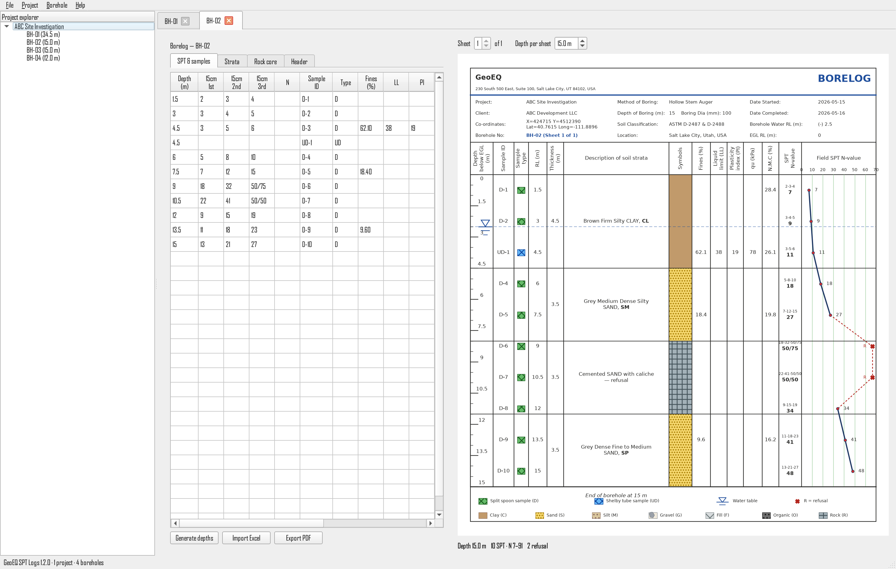
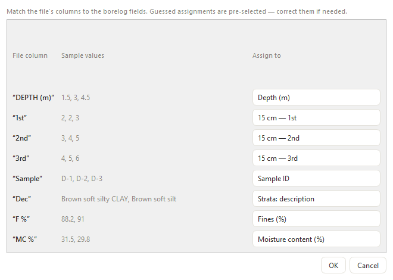
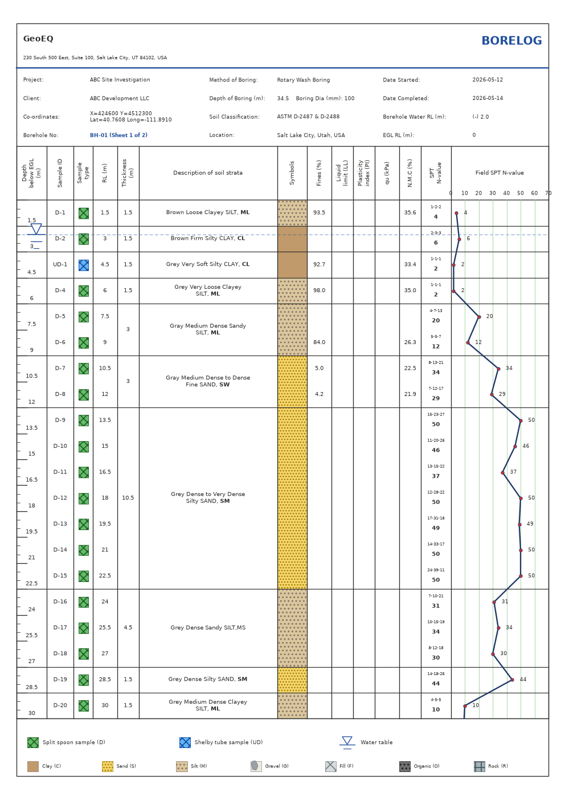

<p align="center">
  
</p>

<h1 align="center">GeoEQ SPT Logs — Free SPT Borelog Software</h1>

<p align="center">
  Create professional <b>SPT borehole logs</b> in minutes — enter or import
  field data, get template-quality <b>geotechnical borelog</b> sheets and
  print-ready PDF reports. Free for Windows.
</p>

<p align="center">
  <a href="https://github.com/geoeq/SPT-Borelogs/releases/latest"></a>
  
  
</p>

<p align="center">
  <a href="#download--install">Download</a> ·
  <a href="manual.md">User manual</a> ·
  <a href="#screenshots">Screenshots</a> ·
  <a href="#faq">FAQ</a> ·
  <a href="#support--feature-requests">Support</a>
</p>

---

## Why GeoEQ SPT Logs?

Most geotechnical teams still draw borehole logs in Excel templates —
slow, error-prone, and painful to keep consistent across a project.
Commercial borelog software is powerful but expensive and heavy.
**GeoEQ SPT Logs** sits in the sweet spot: a free, fast, purpose-built
SPT borelog program that produces clean, standardized boring log sheets
— and imports the Excel files you already have.

- ✅ **Free** (version 1.x, full-featured — see [FAQ](#faq))
- ✅ **Familiar output** — template-style borelog sheets engineers and
  reviewers recognize instantly
- ✅ **Your data stays yours** — plain JSON project files on your disk,
  works fully offline

## Screenshots

**Live borelog editor** — type in the tables on the left, the sheet
redraws instantly on the right:

<p align="center">
  
</p>

**Import any spreadsheet** — non-standard headings are matched with an
assignment window (auto-guessed, you confirm):

<p align="center">
  
</p>

**Print-ready sheets** — A4 borehole log with soil symbols, USCS
classification, groundwater level, and the field SPT N-value profile:

<p align="center">
  
</p>

## Features

- **SPT borehole log sheets** drawn live: ruler depth scale, sample
  symbols (split spoon / Shelby tube), blow counts with computed
  **SPT N-value**, refusal handling, and the N-vs-depth profile graph
- **Soil strata symbols** for Clay, Sand, Silt, Gravel, Fill, Organic
  and Rock — colored, textured, with **USCS group symbols** (ML, CL,
  SW…) printed bold in descriptions
- **Excel & CSV import**: office borelog templates import in one click;
  any other spreadsheet goes through a smart column-mapping dialog —
  even files that only carry N-values
- **Multi-project files**: one file holds several site-investigation
  projects, each with its own boreholes, client, and settings
- **One-click project PDF**: every borehole of a project exported into
  a single multi-page A4 report, in order
- **Your branding**: company name, address and logo, four header
  styles, custom accent color — set once, drawn on every sheet
- **Dual coordinates** (X/Y and Lat/Long), selectable groundwater
  marker styles, water-table level line across the log
- **Offline-first**: no account, no cloud dependency; automatic update
  notifications when you're online

## Download & install

1. Grab the latest Windows package from the
   **[Releases page](https://github.com/geoeq/SPT-Borelogs/releases/latest)**
   (`GeoEQ-SPT-Logs-<version>-setup.exe` or the portable `.zip`).
2. Run the installer, or unzip anywhere and start `GeoEQ SPT Logs.exe`.
3. Requirements: Windows 10 / 11, 64-bit. Nothing else to install.

> New here? Open **File → Open demo project** for a complete example
> borelog you can edit and export straight away.

## Quick start

1. **File → Company settings** — your company name, address, and logo
   (drawn on every sheet).
2. Right-click the project in the explorer → **Add borehole**, or
   **Import borehole from Excel / CSV**.
3. Enter depths, blow counts, samples, and strata — the sheet updates
   live.
4. Right-click the project → **Export project PDF** for the full
   report.

Full guide: **[User manual](manual.md)**.

## Updates

The app checks [`updates/latest.json`](updates/latest.json) at startup
(silently, never blocking — offline machines are unaffected) and shows
a notice with what the new version brings. Critical releases can be
marked required. Manifest fields:

| Field | Meaning |
|---|---|
| `version` | Latest released version — older builds show an update notice |
| `minimum_version` | Builds older than this must update to continue (online only) |
| `download_url` | Where the notice's Download button points |
| `notes` | One-line "what you get" shown in the update notice |
| `promo` *(optional)* | `{id, text, url, menu_text}` — dismissible in-app banner + Help-menu entry; omit for none |

## FAQ

**Is GeoEQ SPT Logs really free?**
Yes — version 1.x is free and full-featured, for both commercial and
personal use.

**Is this an alternative to gINT, LogPlot, or Excel borelog templates?**
It's a lightweight, free alternative for SPT borehole logging: if your
deliverable is a clean SPT boring log with soil strata, lab values, and
the N-value curve, GeoEQ SPT Logs does it with far less setup.

**Can I import my existing Excel borelog data?**
Yes. Standard office templates import in one click; any other
spreadsheet (or CSV) opens a column-assignment window that maps your
headings — "Depth", "SPT N", "Dec", anything — to the right fields.

**Does it work offline?**
Completely. Projects are plain files on your disk
(`Documents\GeoEQ SPT Logs\Projects`); no account or internet needed.

**What is the SPT N-value on the log?**
The Standard Penetration Test blow count: the sum of the 2nd and 3rd
150 mm increments. The software computes it from your blow counts (or
accepts a direct N), plots it against depth, and caps refusal at 50 on
the graph while printing the true value.

**Will it run on macOS?**
A macOS build is planned. Watch the Releases page.

## Support & feature requests

- **Found a bug?** [Open an issue](https://github.com/geoeq/SPT-Borelogs/issues/new)
  with what you did, what happened, and a screenshot if possible.
- **Want a feature?** [Open an issue](https://github.com/geoeq/SPT-Borelogs/issues/new)
  titled `Feature request: …` and tell us what you need and how you'd
  use it — upcoming versions are planned from these discussions, so
  say what *you* want in the software.
- Check the **[user manual](manual.md)** first for how-tos.

## Citation

If you use GeoEQ SPT Logs in a report, thesis, or publication, please
cite it as:

> Malo, R. C., & Qiu, T. (2026). *GeoEQ SPT Logs* (Version 1.0.0)
> [Computer software]. GeoEQ. https://github.com/geoeq/SPT-Borelogs

BibTeX:

```bibtex
@software{malo2026geoeqsptlogs,
  author  = {Malo, Ripon Chandra and Qiu, Tong},
  title   = {GeoEQ SPT Logs},
  version = {1.0.0},
  year    = {2026},
  publisher = {GeoEQ},
  url     = {https://github.com/geoeq/SPT-Borelogs}
}
```

(You can also use GitHub's **"Cite this repository"** button, powered
by [`CITATION.cff`](CITATION.cff).)

## About GeoEQ

**[GeoEQ](https://geoeq.org)** is a geotechnical software studio built
on the `geoeq` Python ecosystem — engineering tools that are fast,
honest about their methods, and pleasant to use. GeoEQ SPT Logs is the
first desktop release.

---

<p align="center">
© GeoEQ · <a href="https://geoeq.org">geoeq.org</a> · This repository
distributes compiled builds; the source code is not published here.
Redistribution of the binaries without permission is not allowed.
</p>
